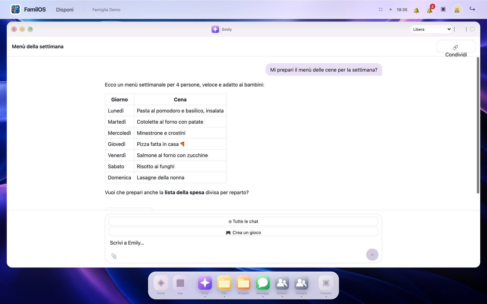
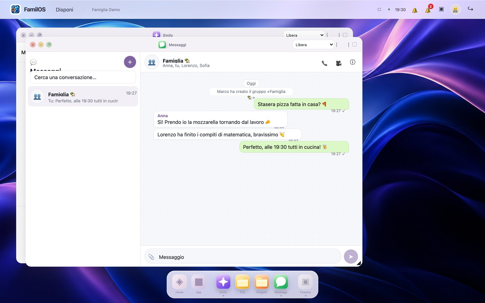
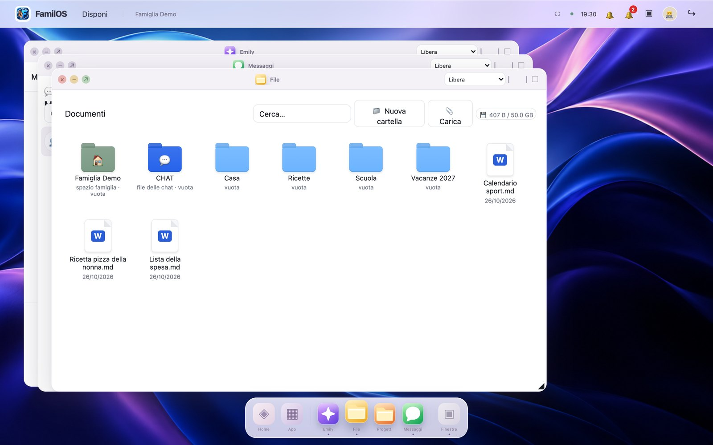
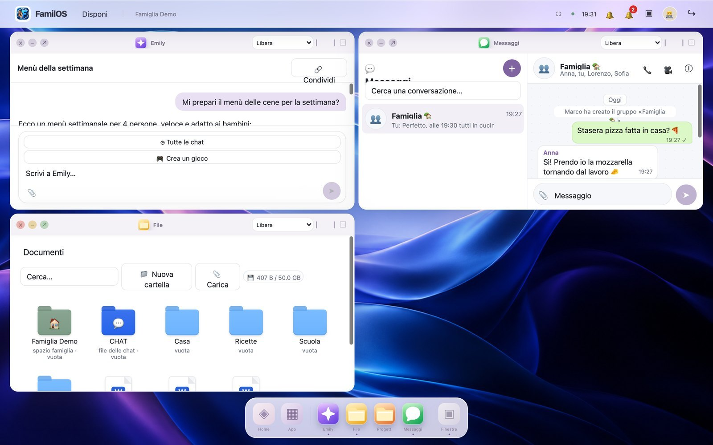
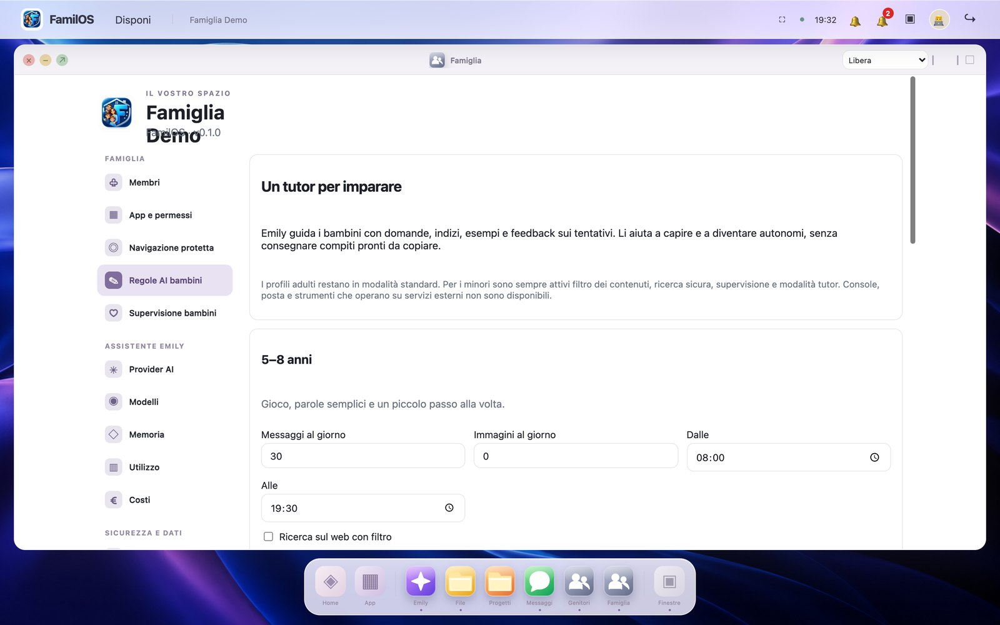
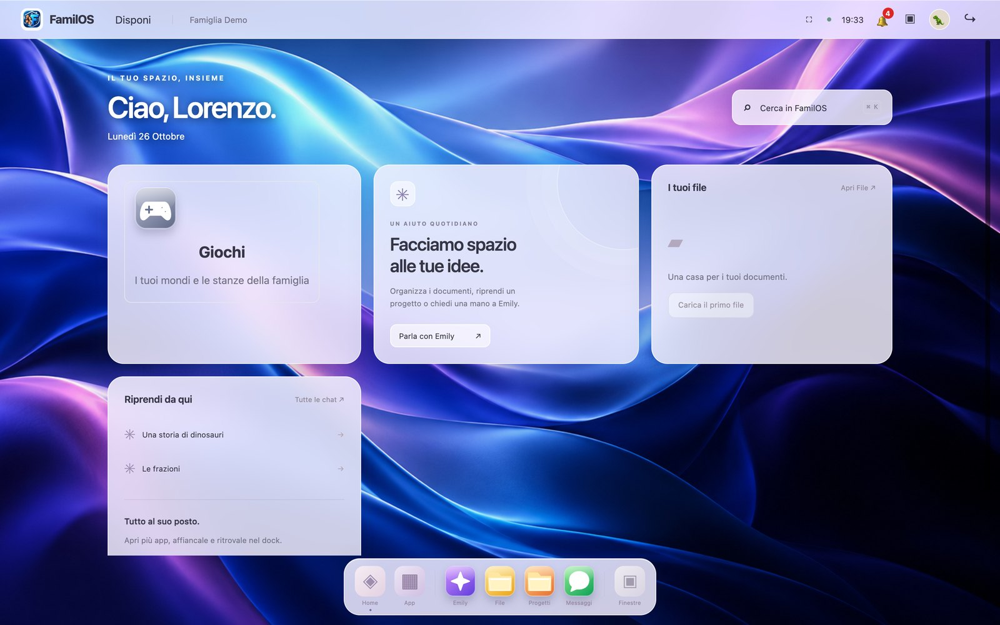
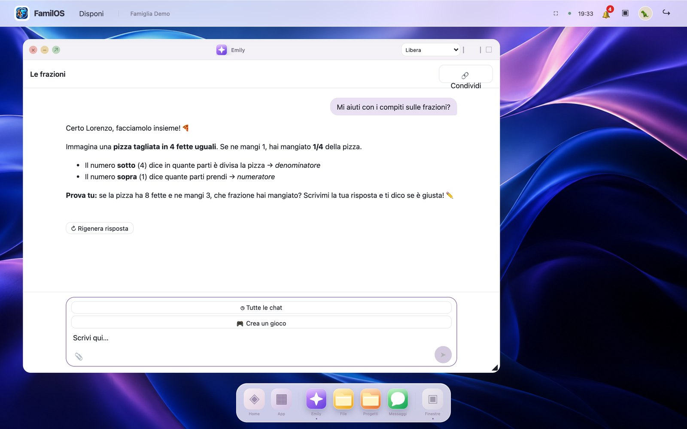
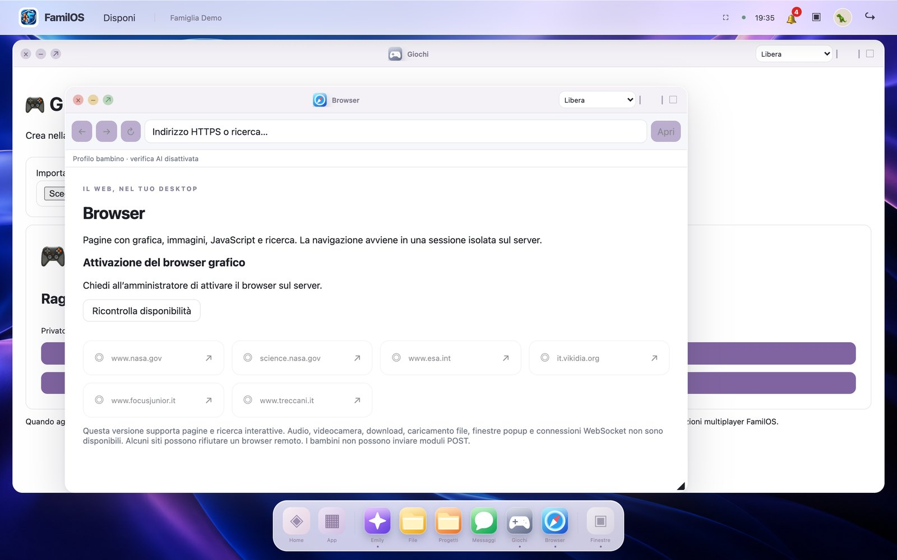

# FamilOS

**FamilOS** is a self-hosted web desktop for the whole family. It runs on your own server and gives every member a personal workspace in the browser — with draggable, tiling windows, a dock and search — built around **Emily**, an AI assistant that works with the provider you choose: OpenAI, Anthropic Claude, Google Gemini, a local model through Ollama, or any OpenAI-compatible API (OpenRouter, Groq, Mistral, DeepSeek, vLLM, LM Studio…).

- **AI chat and projects** with tools, document search (RAG), long-term family memory, image generation and text-to-speech.
- **Files and collaboration:** folders, sharing, version history, and integrated apps for documents, spreadsheets, PDFs, slides, whiteboards and email.
- **Family communication:** messaging, voice and video calls, push notifications.
- **Designed for kids:** child profiles with parental controls, daily limits, a tutor mode that guides instead of giving answers, an isolated safe browser with admin approvals, and a game studio where children create games in chat and play them together in moderated family rooms.
- **Security first:** passkeys, TOTP, Google sign-in, login alerts, audited admin actions and sandboxed third-party apps.
- **Easy to run:** a single Docker Compose stack behind Caddy with automatic HTTPS, backups and in-browser updates.

## Screenshots

> Demo instance with a fictional family and simulated AI replies.

| | |
|---|---|
|  **Home desktop** — widgets, recent chats and files, dock |  **Emily** — the family AI assistant |
|  **Messages** — family group chat with voice and video calls |  **Files** — folders, sharing and versions |
|  **Multitasking** — free, two-zone and four-zone window layouts |  **Parental controls** — AI rules, limits and schedules per age group |

### For kids

| | |
|---|---|
|  **Child desktop** — same familiar shell, protected profile |  **Homework tutor** — Emily guides step by step instead of giving the answer |
|  **Safe browser** — isolated server-side browsing, enabled by parents | |

---

## Documentazione (italiano)

Desktop web per la famiglia, derivato da [Emily](https://github.com/rickyb82/emily). FamilOS è la shell; Emily resta l'assistente AI.

## Funzioni

- Home, dock, ricerca e finestre indipendenti: trascinamento, ridimensionamento, affiancamento e minimizzazione.
- File, cartelle, condivisioni, versioni, progetti e chat. Nuova cartella stile macOS, anche dal tasto destro.
- WordCraft, GridCraft, PdfCraft, DeckCraft, IdeaCraft e MailCraft, secondo i permessi dell'utente.
- Provider AI: OpenAI, Claude (Anthropic), Gemini (Google), Ollama e qualsiasi API compatibile OpenAI (OpenRouter, Groq, Mistral, DeepSeek, vLLM, llama.cpp, LM Studio, LocalAI…). Ollama usa l'API nativa per streaming, strumenti e gestione del ragionamento. Per ogni persona l'amministratore sceglie quali provider può usare; per i bambini decide il genitore, e senza il cloud restano solo i provider in casa.
- App mantenute attive quando nascoste; layout ripristinato per utente nel browser. I nuovi documenti non salvati non si riaprono.
- Layout compatto su telefono, temi chiaro/scuro e movimento ridotto.

Moduli telecom, monitoraggio, preventivi commerciali e personale rimossi. Calendario, spesa, bacheca e dati offline restano sviluppi futuri. I bambini conservano l'interfaccia protetta precedente.

## Avvio Docker

Richiede Compose v2 recente (supporto a `!override`) e accesso ai repository privati Craft.

```sh
cp .env.example .env
# Impostare SECRET_KEY, ADMIN_EMAIL, ADMIN_PASSWORD e almeno un provider (OPENAI_API_KEY, ANTHROPIC_API_KEY, GEMINI_API_KEY, OLLAMA_URL o CUSTOM_LLM_URL).
./familos.sh dev
```

Aprire http://localhost:8080. Configurare i provider in **Famiglia → Provider AI**.
Ollama nativo su Mac: `OLLAMA_URL=http://host.docker.internal:11434`; scaricare prima il modello con `ollama pull qwen3:8b`.
Ollama in Docker: `COMPOSE_PROFILES=ollama`, `OLLAMA_URL=http://ollama:11434`; scaricare il modello nel servizio.

```sh
./familai.sh github-token
./familos.sh productivity up
```

Il token serve per i repository privati. Le prime build Rust possono essere lunghe. I sorgenti Craft restano nei repository originali.
Vedere [Deployment e sviluppo](docs/DEPLOYMENT.md) per HTTPS, backup e sviluppo locale.

## Verifiche

```sh
cd backend
python -m pytest -q
cd ../frontend
npm ci
npm run typecheck
npm test
npm run build
```

I test coprono isolamento dei file, revisioni concorrenti, Sync, provider consentiti e ciclo di vita delle finestre. OpenAI richiede una chiave valida; MailCraft richiede caselle configurate.

## Salvataggi

Gli editor richiedono `If-Match` oppure una sessione distinta con `base_revision`. Le vecchie immagini WASM usano la sessione fornita dalla shell; le nuove build includono `extras/artcraft/familai-web-patch.py`.
Revisione obsoleta: HTTP 412. Precondizione mancante: HTTP 428. Il file salvato resta intatto.
Compose usa un solo worker: le scritture browser, editor e Sync sono serializzate nel processo. Più worker richiedono un lock distribuito o revisioni transazionali.

## Origine

Emily commit `e9e65454f3c32a466076d0ffc2cc71bf3e71cfa5`. Il repository Emily non viene modificato.
I nomi tecnici `familai.sh`, cookie, header CSRF, percorsi dei dati e protocolli Craft sono mantenuti per compatibilità.

## Installazione personalizzabile

L’app **Installazione**, riservata agli amministratori, gestisce nome/logo, dominio pubblico, Google OAuth, identità passkey e HTTPS. Il logo FamilOS predefinito è sostituibile dal pannello.
Le app si aprono dal pannello Applicazioni nella barra; le app Craft creano i documenti nella stessa finestra. I menu Famiglia e Impostazioni sono organizzati per sezioni.
Guida completa: [Login Google](docs/GOOGLE-LOGIN.md).

## Profili personali e famiglia

Ogni utente può scegliere logo, immagine di sfondo, tema chiaro/scuro, colore principale e blocco automatico da Impostazioni → Aspetto.
Le preferenze sono salvate sul profilo. Il blocco schermo è verificato dal server; lo sblocco supporta password/PIN e passkey con verifica dell'utente.
Face ID, Touch ID e Windows Hello richiedono un dispositivo compatibile, HTTPS e una passkey registrata sul dominio corretto.

Lo spazio famiglia non crea reparti aziendali: la migrazione sposta i file delle vecchie cartelle nello spazio condiviso conservando contenuti e cronologia.
La modalità educativa usa tre fasce (5–8, 9–12, 13–17). Gli adulti mantengono la modalità standard.
L'app Genitori consente risposte dirette per un'ora o fino a fine giornata; filtri, orari e limiti dei minori restano attivi.

## AI e cache

Modelli predefiniti: gpt-6-luna (OpenAI), claude-sonnet-5-5 (Claude), gemini-3.8-flash (Gemini); l'elenco dei modelli viene letto dall'account di ogni provider. Ollama e i server compatibili OpenAI sulla rete di casa contano come locali.
I modelli OpenAI recenti usano Responses con store=false, contabilità separata della cache per utente e prefissi stabili.
Cache auto: riusa anche la conversazione quando possibile. Cache stable: breakpoint sul prefisso stabile.
Le letture e scritture vengono misurate dai dati usage dell'API; il primo popolamento può costare più dell'input ordinario.
Non vengono memorizzate risposte finali da riutilizzare al posto di una nuova generazione.

## Browser protetto e Pi-hole

Il browser interno usa una modalità lettura: niente script, moduli, iframe o contenuti attivi.
Per i bambini applica la lista dei domini autorizzati e controlla il testo della pagina prima di mostrarlo; i collegamenti vengono ricontrollati.
I controlli automatici possono sbagliare e si affiancano alla supervisione del genitore.

In Famiglia → Navigazione protetta è possibile usare Pi-hole come DNS. Se gira sulla stessa macchina, selezionare auto:
host.docker.internal da Docker, 127.0.0.1 senza Docker. Pi-hole mantiene la porta 53; spostare la sua dashboard su una porta libera se occupa 80/443.
Questa app protegge la navigazione al suo interno; gli altri browser/dispositivi richiedono controlli DNS e di sistema della rete domestica.
